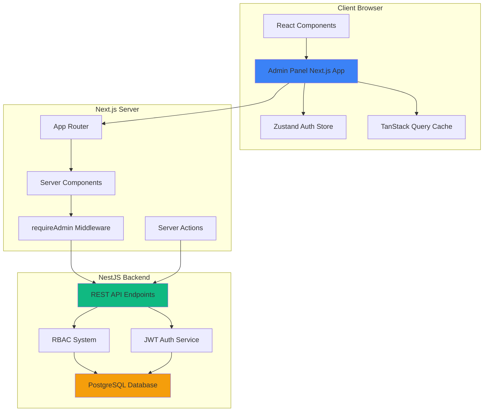
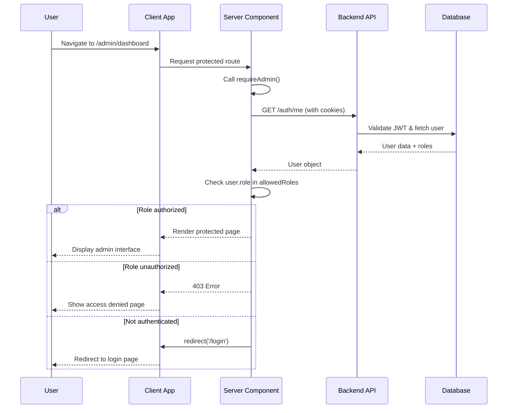
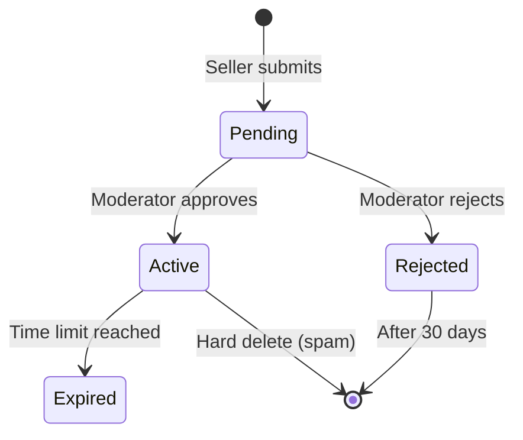

# Admin Panel - Design Document

## Overview

The Admin Panel is a Next.js 14 application using the App Router architecture that provides privileged users (admin, super_admin, moderator, customer_support) with comprehensive administrative capabilities for the multi-vendor marketplace platform. The application leverages server-side rendering for improved security and performance, integrates with the existing NestJS backend API, and implements role-based access control at both route and UI component levels.

### Key Design Goals

1. **Security First**: Server-side authentication checks, role-based route protection, and permission-validated actions
2. **Performance**: Optimistic updates, intelligent caching with TanStack Query, and server components for initial page loads
3. **Maintainability**: Feature-based architecture, strict TypeScript typing, and consistent patterns
4. **User Experience**: Responsive design, loading states, error handling, and clear feedback mechanisms
5. **Scalability**: Modular component structure supporting future feature additions

### Technology Stack

- **Framework**: Next.js 14 (App Router)
- **Language**: TypeScript 5.7+ (strict mode)
- **Styling**: TailwindCSS 3.4+
- **State Management**: 
  - Zustand (auth state)
  - TanStack Query v4 (server state)
  - React Hook Form (form state)
  - URL query parameters (pagination/filter state)
- **Validation**: Zod 3.23+
- **HTTP Client**: Axios 1.4+
- **Backend Integration**: NestJS API (port 3001)

## Architecture

### High-Level Architecture



### Authentication Flow



### Application Layer Structure

```
apps/admin/
├── src/
│   ├── app/                    # Next.js App Router pages
│   │   ├── (auth)/            # Auth layout group
│   │   │   └── login/
│   │   ├── (dashboard)/       # Protected layout group
│   │   │   ├── layout.tsx     # Sidebar + header layout
│   │   │   ├── page.tsx       # Dashboard overview
│   │   │   ├── users/         # User management
│   │   │   ├── listings/      # Listing moderation
│   │   │   ├── reports/       # Report management
│   │   │   ├── verifications/ # Seller verification
│   │   │   ├── chat/          # Chat moderation
│   │   │   ├── notifications/ # Announcements
│   │   │   └── audit-logs/    # Audit viewer
│   │   └── error.tsx          # Error boundary
│   ├── components/            # Shared UI components
│   │   ├── layout/            # Layout components (Sidebar, Header, Nav)
│   │   ├── ui/                # Primitive UI components (Button, Badge, Modal)
│   │   └── shared/            # Complex shared components (DataTable, FilterBar)
│   ├── features/              # Feature-specific modules
│   │   ├── dashboard/
│   │   ├── users/
│   │   ├── listings/
│   │   ├── reports/
│   │   ├── verifications/
│   │   ├── chat/
│   │   ├── notifications/
│   │   └── audit-logs/
│   ├── hooks/                 # Custom React hooks
│   │   ├── useAuth.ts
│   │   ├── useUsers.ts
│   │   ├── useListings.ts
│   │   └── ...
│   ├── lib/                   # Core utilities
│   │   ├── adminApi.ts        # Client-side API client
│   │   ├── adminApiServer.ts  # Server-side API client
│   │   ├── authAdmin.ts       # Server auth helpers
│   │   └── utils.ts           # Helper functions
│   ├── schemas/               # Zod validation schemas
│   │   ├── user.schema.ts
│   │   ├── listing.schema.ts
│   │   └── ...
│   ├── types/                 # TypeScript type definitions
│   │   ├── api.ts             # API request/response types
│   │   ├── models.ts          # Domain model types
│   │   └── index.ts
│   ├── providers/             # React context providers
│   │   ├── QueryProvider.tsx
│   │   └── ToastProvider.tsx
│   └── styles/
│       └── globals.css        # Global styles + Tailwind imports
├── public/
├── next.config.js
├── tailwind.config.js
└── tsconfig.json
```

## Components and Interfaces

### Core Shared Components

#### DataTable Component

A reusable, feature-rich table component for displaying paginated data with sorting and actions.

**Props Interface:**
```typescript
interface DataTableProps<T> {
  columns: ColumnDef<T>[]
  data: T[]
  pagination?: {
    page: number
    pageSize: number
    total: number
    onPageChange: (page: number) => void
  }
  sorting?: {
    sortBy?: string
    sortOrder?: 'asc' | 'desc'
    onSortChange: (sortBy: string, sortOrder: 'asc' | 'desc') => void
  }
  rowActions?: (row: T) => React.ReactNode
  loading?: boolean
  emptyMessage?: string
}

interface ColumnDef<T> {
  key: string
  header: string
  accessor: (row: T) => React.ReactNode
  sortable?: boolean
  width?: string
}
```

**Usage Example:**
```typescript
<DataTable
  columns={userColumns}
  data={users}
  pagination={{ page, pageSize: 20, total, onPageChange: setPage }}
  sorting={{ sortBy, sortOrder, onSortChange: handleSort }}
  rowActions={(user) => <UserActions user={user} />}
/>
```

#### StatusBadge Component

Displays status with predefined color variants.

**Props Interface:**
```typescript
type BadgeVariant = 'active' | 'pending' | 'rejected' | 'banned' | 'resolved' | 'dismissed'

interface StatusBadgeProps {
  status: BadgeVariant
  label?: string
  size?: 'sm' | 'md' | 'lg'
}
```

**Color Mapping:**
- `active`: Green (bg-green-100 text-green-800)
- `pending`: Yellow (bg-yellow-100 text-yellow-800)
- `rejected`: Red (bg-red-100 text-red-800)
- `banned`: Red dark (bg-red-200 text-red-900)
- `resolved`: Blue (bg-blue-100 text-blue-800)
- `dismissed`: Gray (bg-gray-100 text-gray-800)

#### ConfirmModal Component

Modal for confirming destructive actions with optional reason input.

**Props Interface:**
```typescript
interface ConfirmModalProps {
  isOpen: boolean
  onClose: () => void
  onConfirm: (reason?: string) => Promise<void>
  title: string
  message: string
  requireReason?: boolean
  confirmText?: string
  confirmVariant?: 'danger' | 'warning' | 'primary'
  loading?: boolean
}
```

#### PageHeader Component

Consistent page header with breadcrumbs and action buttons.

**Props Interface:**
```typescript
interface PageHeaderProps {
  title: string
  breadcrumbs?: { label: string; href?: string }[]
  actions?: React.ReactNode
  description?: string
}
```

#### StatCard Component

Dashboard metric card with icon, value, and trend indicator.

**Props Interface:**
```typescript
interface StatCardProps {
  title: string
  value: string | number
  icon: React.ReactNode
  trend?: {
    value: number
    direction: 'up' | 'down'
    label: string
  }
  loading?: boolean
}
```

#### FilterBar Component

Unified filter interface with search, sort, and filter controls.

**Props Interface:**
```typescript
interface FilterBarProps {
  searchPlaceholder?: string
  searchValue?: string
  onSearchChange?: (value: string) => void
  filters?: FilterDef[]
  sortOptions?: SortOption[]
  currentSort?: string
  onSortChange?: (value: string) => void
}

interface FilterDef {
  key: string
  label: string
  options: { value: string; label: string }[]
  value?: string
  onChange: (value: string) => void
}
```

### Layout Components

#### AdminLayout Component

Main layout wrapper with sidebar navigation and header.

**Structure:**
```tsx
<div className="flex h-screen bg-gray-50">
  {/* Sidebar - collapsible on mobile */}
  <Sidebar />
  
  <div className="flex-1 flex flex-col overflow-hidden">
    {/* Header with user menu */}
    <Header />
    
    {/* Main content area with scroll */}
    <main className="flex-1 overflow-y-auto p-6">
      {children}
    </main>
  </div>
</div>
```

#### Sidebar Component

Navigation sidebar with role-based menu items.

**Navigation Structure:**
```typescript
const navItems = [
  { label: 'Dashboard', href: '/admin', icon: HomeIcon, roles: ['*'] },
  { label: 'Users', href: '/admin/users', icon: UsersIcon, roles: ['admin', 'super_admin'] },
  { label: 'Listings', href: '/admin/listings', icon: ListIcon, roles: ['admin', 'super_admin', 'moderator'] },
  { label: 'Reports', href: '/admin/reports', icon: FlagIcon, roles: ['admin', 'super_admin', 'moderator'] },
  { label: 'Verifications', href: '/admin/verifications', icon: CheckIcon, roles: ['admin', 'super_admin'] },
  { label: 'Chat Moderation', href: '/admin/chat', icon: MessageIcon, roles: ['admin', 'super_admin', 'moderator'] },
  { label: 'Notifications', href: '/admin/notifications', icon: BellIcon, roles: ['admin', 'super_admin'] },
  { label: 'Audit Logs', href: '/admin/audit-logs', icon: ClipboardIcon, roles: ['super_admin'] },
]
```

### Feature Module Components

#### User Management Module

**Components:**
- `UserList`: Main user listing with table
- `UserFilters`: Search and filter controls
- `UserDetail`: Full user profile page
- `UserActions`: Action buttons (suspend, ban, edit)
- `UserStatusBadge`: User status indicator

**Key Interactions:**
1. Search users by email/name (debounced 300ms)
2. Filter by role and status
3. Sort by name, email, created date
4. Navigate to detail page on row click
5. Perform admin actions with permission checks

#### Listing Moderation Module

**Components:**
- `ListingGrid`: Card-based listing display
- `ListingFilters`: Status tabs and search
- `ListingDetail`: Full listing review page
- `ModerationActions`: Approve/reject/feature controls
- `ListingPreview`: Image gallery and metadata

**Status Flow:**


#### Report Management Module

**Components:**
- `ReportTable`: Paginated report listing
- `ReportFilters`: Type and status filters
- `ReportDetail`: Full report investigation page
- `ReportedEntityPreview`: Shows reported user/listing context
- `ResolutionForm`: Status update and notes

**Report Resolution Workflow:**
1. Moderator opens report
2. Reviews reported entity (user profile or listing)
3. Investigates using provided evidence
4. Updates status (Under Review → Resolved/Dismissed)
5. Adds resolution notes
6. System logs action to audit log

#### Dashboard Module

**Components:**
- `DashboardStats`: Grid of StatCards
- `RecentActivity`: Timeline of admin actions
- `QuickActions`: Shortcuts to common tasks
- `SystemHealth`: API status indicators

**Real-time Updates:**
- Statistics refresh every 60 seconds using TanStack Query polling
- Activity feed updates via query invalidation

## Data Models

### TypeScript Interfaces

#### User Types
```typescript
interface User {
  id: string
  email: string
  name?: string
  role: 'buyer' | 'seller' | 'moderator' | 'admin' | 'super_admin' | 'customer_support'
  status: 'active' | 'suspended' | 'banned' | 'pending_verification'
  emailVerifiedAt?: Date
  phoneVerifiedAt?: Date
  createdAt: Date
  updatedAt: Date
}
```

interface UserModeration {
  userId: string
  action: 'suspend' | 'ban' | 'warn'
  reason: string
  moderatorId: string
  createdAt: Date
}

interface AuthUser {
  id: string
  email: string
  name?: string
  role: string
  permissions: string[]
}
```

#### Listing Types
```typescript
interface Listing {
  id: string
  title: string
  description: string
  price: number
  category: string
  sellerId: string
  sellerName: string
  status: 'pending' | 'active' | 'rejected' | 'expired'
  isFeatured: boolean
  images: string[]
  createdAt: Date
  updatedAt: Date
  rejectionReason?: string
}

interface ListingModeration {
  listingId: string
  action: 'approve' | 'reject' | 'feature' | 'delete'
  reason?: string
  moderatorId: string
  createdAt: Date
}
```

#### Report Types
```typescript
interface Report {
  id: string
  reporterId: string
  reporterName: string
  reportedEntityType: 'user' | 'listing'
  reportedEntityId: string
  reportType: 'scam' | 'abuse' | 'spam' | 'other'
  reason: string
  status: 'pending' | 'under_review' | 'resolved' | 'dismissed'
  resolutionNotes?: string
  createdAt: Date
  updatedAt: Date
}
```

#### Verification Types
```typescript
interface VerificationRequest {
  id: string
  userId: string
  userName: string
  documentType: 'id' | 'business_license' | 'tax_document'
  documentUrls: string[]
  status: 'pending' | 'approved' | 'rejected'
  rejectionReason?: string
  reviewerId?: string
  createdAt: Date
  reviewedAt?: Date
}
```

#### Audit Log Types
```typescript
interface AuditLog {
  id: string
  adminId: string
  adminName: string
  action: string
  targetEntity: string
  targetId: string
  metadata: Record<string, any>
  ipAddress: string
  createdAt: Date
}
```

#### Notification Types
```typescript
interface Announcement {
  title: string
  body: string
  audience: 'all' | 'buyers' | 'sellers' | 'admins'
}

interface AnnouncementResponse {
  id: string
  recipientCount: number
  sentAt: Date
}
```

### API Request/Response Types

```typescript
// Pagination
interface PaginatedRequest {
  page?: number
  pageSize?: number
  sortBy?: string
  sortOrder?: 'asc' | 'desc'
}

interface PaginatedResponse<T> {
  data: T[]
  pagination: {
    page: number
    pageSize: number
    total: number
    totalPages: number
  }
}
```

// User Management
interface UserListRequest extends PaginatedRequest {
  search?: string
  role?: string
  status?: string
}

interface SuspendUserRequest {
  reason: string
}

interface BanUserRequest {
  reason: string
}

// Listing Moderation
interface ListingListRequest extends PaginatedRequest {
  status?: string
  sellerId?: string
  category?: string
}

interface RejectListingRequest {
  reason: string
}

// Report Management
interface ReportListRequest extends PaginatedRequest {
  type?: string
  status?: string
}

interface UpdateReportRequest {
  status: 'under_review' | 'resolved' | 'dismissed'
  resolutionNotes?: string
}

// API Error Response
interface ApiError {
  error: {
    message: string
    code?: string
    details?: any
  }
}
```

## Routing Structure

### Next.js App Router Organization

```
app/
├── (auth)/
│   └── login/
│       └── page.tsx                    # Login page (public)
│
└── (dashboard)/
    ├── layout.tsx                      # AdminLayout with sidebar
    ├── page.tsx                        # Dashboard overview (requireAdmin)
    ├── users/
    │   ├── page.tsx                    # User list (requireAdmin(['admin', 'super_admin']))
    │   └── [id]/
    │       └── page.tsx                # User detail
    ├── listings/
    │   ├── page.tsx                    # Listing list (requireAdmin(['admin', 'super_admin', 'moderator']))
    │   └── [id]/
    │       └── page.tsx                # Listing detail
    ├── reports/
    │   ├── page.tsx                    # Report list (requireAdmin(['admin', 'super_admin', 'moderator']))
    │   └── [id]/
    │       └── page.tsx                # Report detail
    ├── verifications/
    │   ├── page.tsx                    # Verification list (requireAdmin(['admin', 'super_admin']))
    │   └── [id]/
    │       └── page.tsx                # Verification detail
    ├── chat/
    │   ├── page.tsx                    # Chat moderation list (requireAdmin(['admin', 'super_admin', 'moderator']))
    │   └── [id]/
    │       └── page.tsx                # Conversation detail
    ├── notifications/
    │   └── page.tsx                    # Create announcement (requireAdmin(['admin', 'super_admin']))
    └── audit-logs/
        └── page.tsx                    # Audit log viewer (requireAdmin(['super_admin']))
```

### Route Protection Pattern

Each protected page uses the `requireAdmin()` helper:

```typescript
// app/(dashboard)/users/page.tsx
import { requireAdmin } from '@/lib/authAdmin'

export default async function UsersPage() {
  // Server-side auth check before rendering
  const user = await requireAdmin(['admin', 'super_admin'])
  
  return <UserListPage user={user} />
}
```

### URL Query Parameter Patterns

The Admin Panel uses URL query parameters for maintaining filter and pagination state:

```
/admin/users?page=2&search=john&role=seller&status=active&sortBy=createdAt&sortOrder=desc
/admin/listings?page=1&status=pending
/admin/reports?type=scam&status=pending&page=1
/admin/audit-logs?startDate=2024-01-01&endDate=2024-01-31&action=user_suspend
```

**Benefits:**
- Shareable URLs
- Browser back/forward navigation support
- State persistence across page reloads
- Easy deep linking

## State Management Design

### Global Auth State (Zustand)

```typescript
// src/hooks/useAuth.ts
import { create } from 'zustand'

interface AuthState {
  user: AuthUser | null
  isLoading: boolean
  setUser: (user: AuthUser | null) => void
  logout: () => Promise<void>
  hasPermission: (permission: string) => boolean
  hasRole: (roles: string[]) => boolean
}

export const useAuth = create<AuthState>((set, get) => ({
  user: null,
  isLoading: true,
  
  setUser: (user) => set({ user, isLoading: false }),
  
  logout: async () => {
    await apiPost('/auth/logout')
    set({ user: null })
    window.location.href = '/login'
  },
  
  hasPermission: (permission) => {
    const { user } = get()
    return user?.permissions?.includes(permission) ?? false
  },
  
  hasRole: (roles) => {
    const { user } = get()
    return user ? roles.includes(user.role) : false
  },
}))
```

### Server State (TanStack Query)

```typescript
// src/hooks/useUsers.ts
import { useQuery, useMutation, useQueryClient } from '@tanstack/react-query'
import { apiGet, apiPatch, apiDelete } from '@/lib/adminApi'

export function useUsers(params: UserListRequest) {
  return useQuery({
    queryKey: ['users', params],
    queryFn: () => apiGet<PaginatedResponse<User>>('/users', params),
    staleTime: 30000, // 30 seconds
    keepPreviousData: true, // Smooth pagination transitions
  })
}

export function useUser(id: string) {
  return useQuery({
    queryKey: ['users', id],
    queryFn: () => apiGet<User>(`/users/${id}`),
    staleTime: 30000,
  })
}

export function useSuspendUser() {
  const queryClient = useQueryClient()
  
  return useMutation({
    mutationFn: ({ id, reason }: { id: string; reason: string }) =>
      apiPatch(`/users/${id}/suspend`, { reason }),
    onSuccess: () => {
      // Invalidate queries to refetch fresh data
      queryClient.invalidateQueries(['users'])
    },
  })
}

export function useBanUser() {
  const queryClient = useQueryClient()
  
  return useMutation({
    mutationFn: ({ id, reason }: { id: string; reason: string }) =>
      apiPatch(`/users/${id}/ban`, { reason }),
    onSuccess: () => {
      queryClient.invalidateQueries(['users'])
    },
  })
}
```

### Form State (React Hook Form + Zod)

```typescript
// src/schemas/announcement.schema.ts
import { z } from 'zod'

export const announcementSchema = z.object({
  title: z.string().min(1, 'Title is required').max(100, 'Title must be less than 100 characters'),
  body: z.string().min(1, 'Body is required').max(500, 'Body must be less than 500 characters'),
  audience: z.enum(['all', 'buyers', 'sellers', 'admins']),
})

export type AnnouncementFormData = z.infer<typeof announcementSchema>

// Component usage
import { useForm } from 'react-hook-form'
import { zodResolver } from '@hookform/resolvers/zod'

function AnnouncementForm() {
  const { register, handleSubmit, formState: { errors } } = useForm<AnnouncementFormData>({
    resolver: zodResolver(announcementSchema),
  })
  
  const onSubmit = (data: AnnouncementFormData) => {
    // Form is validated by Zod before reaching here
  }
  
  return <form onSubmit={handleSubmit(onSubmit)}>...</form>
}
```

### URL State Management

```typescript
// Custom hook for managing URL query parameters
import { useRouter, useSearchParams } from 'next/navigation'

export function useQueryState<T extends Record<string, any>>(defaults: T) {
  const router = useRouter()
  const searchParams = useSearchParams()
  
  const state = {
    ...defaults,
    ...Object.fromEntries(searchParams.entries()),
  }
  
  const setState = (updates: Partial<T>) => {
    const params = new URLSearchParams(searchParams)
    
    Object.entries(updates).forEach(([key, value]) => {
      if (value === null || value === undefined || value === '') {
        params.delete(key)
      } else {
        params.set(key, String(value))
      }
    })
    
    router.push(`?${params.toString()}`)
  }
  
  return [state, setState] as const
}

// Usage
function UserList() {
  const [filters, setFilters] = useQueryState({
    page: 1,
    search: '',
    role: '',
    status: '',
    sortBy: 'createdAt',
    sortOrder: 'desc',
  })
  
  const handleSearch = (search: string) => {
    setFilters({ search, page: 1 }) // Reset to page 1 on new search
  }
  
  return <div>...</div>
}
```

## API Integration Patterns

### Client-Side API Client

```typescript
// src/lib/adminApi.ts
import axios, { AxiosError } from 'axios'

const API_BASE = process.env.NEXT_PUBLIC_API_URL || 'http://localhost:3001/api/v1'

// Create axios instance with defaults
const apiClient = axios.create({
  baseURL: API_BASE,
  withCredentials: true, // Include cookies for auth
  headers: {
    'Content-Type': 'application/json',
  },
})

// Response interceptor for global error handling
apiClient.interceptors.response.use(
  (response) => response,
  async (error: AxiosError<ApiError>) => {
    if (error.response?.status === 401) {
      // Unauthorized - redirect to login
      window.location.href = '/login'
    } else if (error.response?.status === 403) {
      // Forbidden - show permission error
      throw new Error('You do not have permission to perform this action')
    }
    
    // Extract error message from API response
    const message = error.response?.data?.error?.message || 'An error occurred'
    throw new Error(message)
  }
)

export async function apiGet<T = any>(path: string, params?: Record<string, any>): Promise<T> {
  const response = await apiClient.get<T>(path, { params })
  return response.data
}

export async function apiPost<T = any>(path: string, data?: any): Promise<T> {
  const response = await apiClient.post<T>(path, data)
  return response.data
}

export async function apiPatch<T = any>(path: string, data?: any): Promise<T> {
  const response = await apiClient.patch<T>(path, data)
  return response.data
}

export async function apiDelete<T = any>(path: string): Promise<T> {
  const response = await apiClient.delete<T>(path)
  return response.data
}
```

### Server-Side API Client

```typescript
// src/lib/adminApiServer.ts
import { cookies } from 'next/headers'

const API_BASE = process.env.NEXT_PUBLIC_API_URL || 'http://localhost:3001/api/v1'

interface ServerApiOptions {
  revalidate?: number
  tags?: string[]
}

export async function serverGet<T = any>(
  path: string,
  options?: ServerApiOptions
): Promise<T> {
  const cookieStore = cookies()
  const cookieHeader = cookieStore.getAll()
    .map(c => `${c.name}=${c.value}`)
    .join('; ')
  
  const fetchOptions: RequestInit = {
    credentials: 'include',
    headers: {
      'Cookie': cookieHeader,
      'Content-Type': 'application/json',
    },
  }
  
  // Next.js caching options
  if (options?.revalidate !== undefined) {
    fetchOptions.next = { revalidate: options.revalidate, tags: options.tags }
  } else {
    fetchOptions.cache = 'no-store' // No caching for admin data by default
  }
  
  const response = await fetch(`${API_BASE}${path}`, fetchOptions)
  
  if (!response.ok) {
    throw new Error(`API Error: ${response.status}`)
  }
  
  return response.json()
}

export async function serverPost<T = any>(path: string, data?: any): Promise<T> {
  const cookieStore = cookies()
  const cookieHeader = cookieStore.getAll()
    .map(c => `${c.name}=${c.value}`)
    .join('; ')
  
  const response = await fetch(`${API_BASE}${path}`, {
    method: 'POST',
    credentials: 'include',
    headers: {
      'Cookie': cookieHeader,
      'Content-Type': 'application/json',
    },
    body: JSON.stringify(data),
    cache: 'no-store',
  })
  
  if (!response.ok) {
    throw new Error(`API Error: ${response.status}`)
  }
  
  return response.json()
}
```

### Authentication Helpers

```typescript
// src/lib/authAdmin.ts
import { serverGet } from './adminApiServer'
import { redirect } from 'next/navigation'

export interface AuthUser {
  id: string
  email: string
  name?: string
  role: string
  permissions: string[]
}

const DEFAULT_ADMIN_ROLES = ['admin', 'super_admin', 'moderator', 'customer_support']

export async function requireAdmin(allowedRoles: string[] = DEFAULT_ADMIN_ROLES): Promise<AuthUser> {
  try {
    const user = await serverGet<AuthUser>('/auth/me')
    
    // Check if user has required role
    if (!allowedRoles.includes(user.role)) {
      throw new Error('Insufficient permissions')
    }
    
    return user
  } catch (error) {
    // Redirect to login if not authenticated
    redirect('/login')
  }
}

export async function getAdminUser(): Promise<AuthUser | null> {
  try {
    const user = await serverGet<AuthUser>('/auth/me')
    return user
  } catch {
    return null
  }
}
```

## Error Handling

### Error Boundary

```typescript
// app/error.tsx
'use client'

import { useEffect } from 'react'

export default function Error({
  error,
  reset,
}: {
  error: Error & { digest?: string }
  reset: () => void
}) {
  useEffect(() => {
    console.error('Error:', error)
  }, [error])

  return (
    <div className="flex min-h-screen items-center justify-center bg-gray-50">
      <div className="text-center">
        <h2 className="text-2xl font-bold text-gray-900 mb-4">
          Something went wrong!
        </h2>
        <p className="text-gray-600 mb-6">{error.message}</p>
        <button
          onClick={reset}
          className="px-4 py-2 bg-blue-600 text-white rounded-lg hover:bg-blue-700"
        >
          Try again
        </button>
      </div>
    </div>
  )
}
```

### Toast Notification System

```typescript
// src/providers/ToastProvider.tsx
'use client'

import { createContext, useContext, useState, ReactNode } from 'react'

type ToastType = 'success' | 'error' | 'warning' | 'info'

interface Toast {
  id: string
  type: ToastType
  message: string
}

interface ToastContextType {
  showToast: (type: ToastType, message: string) => void
}

const ToastContext = createContext<ToastContextType | undefined>(undefined)

export function ToastProvider({ children }: { children: ReactNode }) {
  const [toasts, setToasts] = useState<Toast[]>([])

  const showToast = (type: ToastType, message: string) => {
    const id = Math.random().toString(36)
    setToasts(prev => [...prev, { id, type, message }])
    
    const duration = type === 'error' ? 5000 : 3000
    setTimeout(() => {
      setToasts(prev => prev.filter(t => t.id !== id))
    }, duration)
  }

  return (
    <ToastContext.Provider value={{ showToast }}>
      {children}
      <div className="fixed bottom-4 right-4 z-50 space-y-2">
        {toasts.map(toast => (
          <ToastItem key={toast.id} toast={toast} />
        ))}
      </div>
    </ToastContext.Provider>
  )
}

export function useToast() {
  const context = useContext(ToastContext)
  if (!context) throw new Error('useToast must be used within ToastProvider')
  return context
}
```

### API Error Handling Pattern

```typescript
// Usage in components
import { useToast } from '@/providers/ToastProvider'
import { useSuspendUser } from '@/hooks/useUsers'

function UserActions({ user }: { user: User }) {
  const { showToast } = useToast()
  const suspendUser = useSuspendUser()
  
  const handleSuspend = async (reason: string) => {
    try {
      await suspendUser.mutateAsync({ id: user.id, reason })
      showToast('success', 'User suspended successfully')
    } catch (error) {
      showToast('error', error instanceof Error ? error.message : 'Failed to suspend user')
    }
  }
  
  return <button onClick={() => handleSuspend('Policy violation')}>Suspend</button>
}
```

## Testing Strategy

### Overview

The Admin Panel testing strategy focuses on three complementary layers:

1. **Unit Tests**: Component logic, utility functions, validation schemas
2. **Integration Tests**: API integration, auth flows, form submissions
3. **E2E Tests**: Critical user journeys through the admin interface

**Note on Property-Based Testing**: This feature is **not suitable for property-based testing** because it consists primarily of:
- UI rendering and layout components
- CRUD operations with no complex transformation logic
- API integration and data display
- Authentication and permission checks

These are better validated through unit tests, integration tests, and E2E tests with concrete examples.

### Unit Testing

**Test Coverage:**
- Component rendering and props
- Form validation (Zod schemas)
- Utility functions (formatters, helpers)
- Custom hooks (business logic only)
- Permission checking logic

**Testing Framework:**
- Jest for test runner
- React Testing Library for component tests
- MSW (Mock Service Worker) for API mocking

**Example Unit Tests:**

```typescript
// __tests__/components/StatusBadge.test.tsx
import { render, screen } from '@testing-library/react'
import { StatusBadge } from '@/components/ui/StatusBadge'

describe('StatusBadge', () => {
  it('renders active status with green styling', () => {
    render(<StatusBadge status="active" />)
    const badge = screen.getByText('active')
    expect(badge).toHaveClass('bg-green-100', 'text-green-800')
  })
  
  it('renders custom label', () => {
    render(<StatusBadge status="active" label="Live" />)
    expect(screen.getByText('Live')).toBeInTheDocument()
  })
})
```

```typescript
// __tests__/schemas/announcement.schema.test.ts
import { announcementSchema } from '@/schemas/announcement.schema'

describe('announcementSchema', () => {
  it('validates correct announcement data', () => {
    const data = {
      title: 'Important Update',
      body: 'System maintenance scheduled for tonight.',
      audience: 'all',
    }
    expect(() => announcementSchema.parse(data)).not.toThrow()
  })
  
  it('rejects title exceeding 100 characters', () => {
    const data = {
      title: 'a'.repeat(101),
      body: 'Valid body',
      audience: 'all',
    }
    expect(() => announcementSchema.parse(data)).toThrow()
  })
  
  it('rejects empty body', () => {
    const data = {
      title: 'Valid title',
      body: '',
      audience: 'all',
    }
    expect(() => announcementSchema.parse(data)).toThrow()
  })
})
```

```typescript
// __tests__/lib/authAdmin.test.ts
import { requireAdmin } from '@/lib/authAdmin'
import { serverGet } from '@/lib/adminApiServer'
import { redirect } from 'next/navigation'

jest.mock('@/lib/adminApiServer')
jest.mock('next/navigation')

describe('requireAdmin', () => {
  it('returns user when authenticated with correct role', async () => {
    const mockUser = { id: '1', email: 'admin@test.com', role: 'admin', permissions: [] }
    ;(serverGet as jest.Mock).mockResolvedValue(mockUser)
    
    const user = await requireAdmin(['admin'])
    expect(user).toEqual(mockUser)
  })
  
  it('redirects to login when not authenticated', async () => {
    ;(serverGet as jest.Mock).mockRejectedValue(new Error('Unauthorized'))
    
    await requireAdmin()
    expect(redirect).toHaveBeenCalledWith('/login')
  })
  
  it('throws error when user has insufficient role', async () => {
    const mockUser = { id: '1', email: 'user@test.com', role: 'buyer', permissions: [] }
    ;(serverGet as jest.Mock).mockResolvedValue(mockUser)
    
    await expect(requireAdmin(['admin'])).rejects.toThrow('Insufficient permissions')
  })
})
```

### Integration Testing

**Test Coverage:**
- API client error handling
- TanStack Query cache invalidation
- Form submission flows
- Auth state management
- Toast notifications

**Example Integration Tests:**

```typescript
// __tests__/integration/userSuspension.test.tsx
import { render, screen, waitFor } from '@testing-library/react'
import userEvent from '@testing-library/user-event'
import { QueryClient, QueryClientProvider } from '@tanstack/react-query'
import { rest } from 'msw'
import { setupServer } from 'msw/node'
import { UserActions } from '@/features/users/UserActions'

const server = setupServer(
  rest.patch('http://localhost:3001/api/v1/users/:id/suspend', (req, res, ctx) => {
    return res(ctx.json({ success: true }))
  })
)

beforeAll(() => server.listen())
afterEach(() => server.resetHandlers())
afterAll(() => server.close())

describe('User Suspension Flow', () => {
  it('suspends user and shows success toast', async () => {
    const queryClient = new QueryClient()
    const user = userEvent.setup()
    const mockUser = { id: '1', name: 'Test User', status: 'active' }
    
    render(
      <QueryClientProvider client={queryClient}>
        <UserActions user={mockUser} />
      </QueryClientProvider>
    )
    
    await user.click(screen.getByText('Suspend'))
    await user.type(screen.getByLabelText('Reason'), 'Policy violation')
    await user.click(screen.getByText('Confirm'))
    
    await waitFor(() => {
      expect(screen.getByText('User suspended successfully')).toBeInTheDocument()
    })
  })
  
  it('displays error toast on API failure', async () => {
    server.use(
      rest.patch('http://localhost:3001/api/v1/users/:id/suspend', (req, res, ctx) => {
        return res(ctx.status(500), ctx.json({ error: { message: 'Server error' } }))
      })
    )
    
    // ... test implementation
  })
})
```

### E2E Testing

**Test Coverage:**
- Critical admin workflows
- Multi-step processes
- Cross-page navigation
- Permission-based access

**Testing Framework:** Playwright or Cypress

**Example E2E Test Scenarios:**

```typescript
// e2e/userModeration.spec.ts
import { test, expect } from '@playwright/test'

test.describe('User Moderation Workflow', () => {
  test.beforeEach(async ({ page }) => {
    // Login as admin
    await page.goto('http://localhost:3000/login')
    await page.fill('input[name="email"]', 'admin@test.com')
    await page.fill('input[name="password"]', 'password')
    await page.click('button[type="submit"]')
    await expect(page).toHaveURL('http://localhost:3000/admin')
  })
  
  test('admin can suspend a user', async ({ page }) => {
    // Navigate to users page
    await page.goto('http://localhost:3000/admin/users')
    
    // Search for user
    await page.fill('input[placeholder="Search users"]', 'john@example.com')
    await page.waitForTimeout(500) // Wait for debounce
    
    // Click on user
    await page.click('text=john@example.com')
    await expect(page).toHaveURL(/\/admin\/users\/\w+/)
    
    // Suspend user
    await page.click('button:has-text("Suspend")')
    await page.fill('textarea[name="reason"]', 'Policy violation')
    await page.click('button:has-text("Confirm")')
    
    // Verify success
    await expect(page.locator('text=User suspended successfully')).toBeVisible()
    await expect(page.locator('text=suspended')).toBeVisible()
  })
  
  test('moderator cannot access user management', async ({ page }) => {
    // Login as moderator (different role)
    await page.goto('http://localhost:3000/login')
    await page.fill('input[name="email"]', 'moderator@test.com')
    await page.fill('input[name="password"]', 'password')
    await page.click('button[type="submit"]')
    
    // Try to access users page
    await page.goto('http://localhost:3000/admin/users')
    
    // Should see 403 error or be redirected
    await expect(page.locator('text=Access Denied')).toBeVisible()
  })
})
```

```typescript
// e2e/listingModeration.spec.ts
test('moderator can approve listing', async ({ page }) => {
  await page.goto('http://localhost:3000/admin/listings')
  
  // Filter pending listings
  await page.click('text=Pending')
  
  // Click on first listing
  await page.click('table tbody tr:first-child')
  
  // Approve listing
  await page.click('button:has-text("Approve")')
  
  // Verify success
  await expect(page.locator('text=Listing approved')).toBeVisible()
  await expect(page.locator('text=active')).toBeVisible()
})
```

### Test Data Management

**Fixtures:**
```typescript
// __tests__/fixtures/users.ts
export const mockUsers = {
  admin: {
    id: '1',
    email: 'admin@test.com',
    name: 'Admin User',
    role: 'admin',
    status: 'active',
    permissions: ['user:suspend', 'user:ban', 'listing:approve'],
  },
  moderator: {
    id: '2',
    email: 'moderator@test.com',
    name: 'Moderator User',
    role: 'moderator',
    status: 'active',
    permissions: ['listing:approve', 'listing:reject', 'report:resolve'],
  },
  regularUser: {
    id: '3',
    email: 'user@test.com',
    name: 'Regular User',
    role: 'buyer',
    status: 'active',
    permissions: [],
  },
}
```

### Coverage Goals

- **Unit Tests**: 80%+ coverage for utilities and business logic
- **Integration Tests**: All API endpoints and critical flows
- **E2E Tests**: Key user journeys (5-10 critical paths)

## Responsive Design Strategy

### Breakpoint System

TailwindCSS breakpoints:
- `sm`: 640px (mobile landscape)
- `md`: 768px (tablets)
- `lg`: 1024px (desktop)
- `xl`: 1280px (large desktop)
- `2xl`: 1536px (extra large)

### Layout Adaptations

#### Sidebar Navigation

**Desktop (≥768px):**
```tsx
<aside className="w-64 bg-white border-r border-gray-200">
  <nav className="p-4">
    {navItems.map(item => (
      <NavLink key={item.href} {...item} />
    ))}
  </nav>
</aside>
```

**Mobile (<768px):**
```tsx
<MobileMenu isOpen={isOpen} onClose={() => setIsOpen(false)}>
  <nav className="p-4">
    {navItems.map(item => (
      <NavLink key={item.href} {...item} onClick={() => setIsOpen(false)} />
    ))}
  </nav>
</MobileMenu>
```

#### Data Tables

**Desktop:**
- Full table with all columns
- Hover states for row actions
- Fixed header on scroll

**Tablet:**
- Hide less critical columns
- Condensed spacing

**Mobile:**
- Card-based layout instead of table
- Horizontal scroll for necessary tables
- Collapsible rows for details

```tsx
<div className="hidden md:block">
  <DataTable columns={allColumns} data={data} />
</div>

<div className="md:hidden space-y-4">
  {data.map(item => (
    <MobileCard key={item.id} data={item} />
  ))}
</div>
```

#### Forms

**Desktop:**
```tsx
<div className="grid grid-cols-2 gap-6">
  <input className="col-span-1" />
  <input className="col-span-1" />
</div>
```

**Mobile:**
```tsx
<div className="grid grid-cols-1 gap-4">
  <input className="col-span-1" />
  <input className="col-span-1" />
</div>
```

### Touch Targets

All interactive elements maintain minimum 44x44px touch targets on mobile:

```tsx
<button className="px-4 py-3 min-h-[44px] min-w-[44px]">
  Action
</button>
```

### Typography Scaling

```css
/* globals.css */
body {
  @apply text-sm md:text-base;
}

h1 {
  @apply text-2xl md:text-3xl lg:text-4xl;
}

h2 {
  @apply text-xl md:text-2xl lg:text-3xl;
}
```

## Security Considerations

### Authentication Security

1. **HttpOnly Cookies**: Tokens stored in HttpOnly cookies prevent XSS attacks
2. **Secure Flag**: Cookies sent only over HTTPS in production
3. **SameSite**: CSRF protection via SameSite cookie attribute
4. **Token Expiration**: Access tokens expire after 15 minutes, refresh tokens after 7 days
5. **Server-Side Validation**: All protected routes validate auth on the server before rendering

### Authorization Security

1. **Role-Based Access Control**: Routes protected by role requirements
2. **Permission Checks**: UI actions validated against user permissions
3. **Backend Enforcement**: All mutations verified by backend API (defense in depth)
4. **Principle of Least Privilege**: Users granted minimum necessary permissions

### Data Security

1. **Input Validation**: All form inputs validated with Zod schemas
2. **SQL Injection Prevention**: Backend uses Prisma ORM with parameterized queries
3. **XSS Prevention**: React automatically escapes rendered content
4. **Rate Limiting**: API endpoints protected by rate limiting (backend)
5. **Audit Logging**: All admin actions logged with user ID, timestamp, and IP address

### API Security

1. **CORS Configuration**: Strict origin whitelist in production
2. **CSRF Protection**: Token-based CSRF prevention for mutations
3. **Request Size Limits**: File upload and payload size limits
4. **Error Messages**: Generic error messages to prevent information disclosure

### Content Security Policy

```javascript
// next.config.js
const securityHeaders = [
  {
    key: 'X-DNS-Prefetch-Control',
    value: 'on',
  },
  {
    key: 'Strict-Transport-Security',
    value: 'max-age=63072000; includeSubDomains; preload',
  },
  {
    key: 'X-Frame-Options',
    value: 'SAMEORIGIN',
  },
  {
    key: 'X-Content-Type-Options',
    value: 'nosniff',
  },
  {
    key: 'Referrer-Policy',
    value: 'origin-when-cross-origin',
  },
]
```

## Performance Optimizations

### Server-Side Rendering

- Initial page loads use server components for faster FCP
- Reduced JavaScript bundle size on client
- SEO benefits for admin dashboard (if needed)

### Code Splitting

```typescript
// Lazy load heavy components
const ReportDetail = dynamic(() => import('@/features/reports/ReportDetail'), {
  loading: () => <Skeleton />,
})
```

### Image Optimization

```tsx
import Image from 'next/image'

<Image
  src={listing.thumbnail}
  alt={listing.title}
  width={200}
  height={200}
  className="rounded-lg"
/>
```

### TanStack Query Optimizations

1. **Stale Time**: 30 seconds to reduce unnecessary refetches
2. **Cache Time**: 5 minutes to keep inactive data in memory
3. **Prefetching**: Prefetch next page on pagination
4. **Optimistic Updates**: Immediate UI updates before API confirmation
5. **Query Deduplication**: Automatic deduplication of identical requests

### Bundle Size Management

1. **Tree Shaking**: Unused code eliminated in production build
2. **Minimal Dependencies**: Only essential libraries included
3. **Font Optimization**: Next.js automatic font optimization
4. **Icon Libraries**: Import only used icons

## Deployment Configuration

### Environment Variables

```bash
# .env.example
NEXT_PUBLIC_API_URL=http://localhost:3001/api/v1
NODE_ENV=development
```

Production:
```bash
NEXT_PUBLIC_API_URL=https://api.marketplace.com/api/v1
NODE_ENV=production
```

### Build Configuration

```javascript
// next.config.js
/** @type {import('next').NextConfig} */
const nextConfig = {
  reactStrictMode: true,
  swcMinify: true,
  
  images: {
    domains: ['storage.marketplace.com'],
    formats: ['image/webp', 'image/avif'],
  },
  
  async headers() {
    return [
      {
        source: '/:path*',
        headers: securityHeaders,
      },
    ]
  },
  
  async redirects() {
    return [
      {
        source: '/',
        destination: '/admin',
        permanent: true,
      },
    ]
  },
}

module.exports = nextConfig
```

### TypeScript Configuration

```json
{
  "compilerOptions": {
    "target": "ES2020",
    "lib": ["ES2020", "DOM", "DOM.Iterable"],
    "jsx": "preserve",
    "module": "esnext",
    "moduleResolution": "bundler",
    "resolveJsonModule": true,
    "allowJs": true,
    "strict": true,
    "noEmit": true,
    "incremental": true,
    "esModuleInterop": true,
    "skipLibCheck": true,
    "forceConsistentCasingInFileNames": true,
    "paths": {
      "@/*": ["./src/*"]
    },
    "plugins": [{ "name": "next" }]
  },
  "include": ["next-env.d.ts", "**/*.ts", "**/*.tsx"],
  "exclude": ["node_modules"]
}
```

## Implementation Roadmap

### Phase 1: Foundation (Week 1)

**Tasks:**
1. Setup Next.js 14 project structure
2. Configure TailwindCSS and TypeScript
3. Create basic layout components (Sidebar, Header)
4. Implement auth helpers (requireAdmin, API clients)
5. Setup TanStack Query and Zustand
6. Create shared UI components (Button, Badge, Modal)

**Deliverables:**
- Working Next.js app with layout
- Auth middleware functional
- Component library foundation

### Phase 2: Core Features (Week 2-3)

**Module Implementation Order:**
1. Dashboard Overview (statistics and activity feed)
2. User Management (list, search, filter, detail)
3. Listing Moderation (review, approve, reject)
4. Report Management (view, resolve)

**Deliverables:**
- Four core modules functional
- Data tables working with pagination
- Form submissions with validation
- Toast notifications

### Phase 3: Advanced Features (Week 4)

**Tasks:**
1. Seller Verification Module
2. Chat Moderation Module
3. Notification Module (announcements)
4. Audit Log Viewer

**Deliverables:**
- All modules complete
- Permission-based UI rendering
- Audit logging integrated

### Phase 4: Polish and Testing (Week 5)

**Tasks:**
1. Responsive design refinement
2. Error handling improvements
3. Loading state optimization
4. Unit test coverage
5. Integration tests
6. E2E critical paths

**Deliverables:**
- Mobile-responsive interface
- 80%+ test coverage
- Performance optimization
- Documentation

### Phase 5: Deployment (Week 6)

**Tasks:**
1. Production environment setup
2. Security hardening
3. Performance monitoring
4. User acceptance testing
5. Deployment to production

**Deliverables:**
- Production-ready application
- Monitoring and alerting
- Admin user training materials

## Dependencies

### Core Dependencies

```json
{
  "dependencies": {
    "next": "^14.0.0",
    "react": "^18.2.0",
    "react-dom": "^18.2.0",
    "typescript": "^5.7.3",
    
    "tailwindcss": "^3.4.8",
    "postcss": "^8.4.0",
    "autoprefixer": "^10.4.0",
    
    "@tanstack/react-query": "^4.36.0",
    "zustand": "^4.4.0",
    "react-hook-form": "^7.45.0",
    "@hookform/resolvers": "^3.3.0",
    "zod": "^3.23.0",
    
    "axios": "^1.4.0",
    "date-fns": "^2.30.0",
    "clsx": "^2.0.0",
    
    "@marketplace/types": "*",
    "@marketplace/utils": "*"
  },
  "devDependencies": {
    "@types/react": "^18.2.0",
    "@types/react-dom": "^18.2.0",
    "@types/node": "^20.0.0",
    
    "jest": "^29.5.0",
    "@testing-library/react": "^14.0.0",
    "@testing-library/user-event": "^14.4.0",
    "@testing-library/jest-dom": "^6.0.0",
    "msw": "^1.2.0",
    
    "playwright": "^1.40.0",
    
    "eslint": "^9.18.0",
    "eslint-config-next": "^14.0.0",
    "prettier": "^3.4.2",
    "prettier-plugin-tailwindcss": "^0.6.11"
  }
}
```

## Migration from Stub Implementation

The current `apps/admin` directory contains only a stub implementation. Migration steps:

1. **Backup Current Structure**:
   ```bash
   mv apps/admin apps/admin-old
   ```

2. **Create New Next.js App**:
   ```bash
   npx create-next-app@latest apps/admin --typescript --tailwind --app --src-dir
   ```

3. **Copy Shared Packages**:
   - Ensure `@marketplace/types`, `@marketplace/utils` are available
   - Update package.json dependencies

4. **Implement Core Structure**:
   - Follow the directory structure defined in this document
   - Start with Phase 1 foundation

5. **Remove Old Stub**:
   ```bash
   rm -rf apps/admin-old
   ```

## Open Questions

1. **File Upload**: What cloud storage solution for verification documents? (S3, Cloudinary, etc.)
2. **Real-time Updates**: Should admin panel show real-time updates via WebSocket for activity feed?
3. **Export Functionality**: Do admins need CSV export for users/listings/reports?
4. **Bulk Actions**: Should we support bulk user suspension or listing approval?
5. **Analytics Dashboard**: Should we integrate analytics (charts/graphs) for platform metrics?
6. **Email Templates**: Do moderation actions (suspend, reject) trigger automated email notifications?

## References

- [Next.js 14 Documentation](https://nextjs.org/docs)
- [TanStack Query Documentation](https://tanstack.com/query/latest/docs/react)
- [React Hook Form Documentation](https://react-hook-form.com/)
- [Zod Documentation](https://zod.dev/)
- [TailwindCSS Documentation](https://tailwindcss.com/)
- Backend API Documentation: `services/api/docs/api.md`
- RBAC System: Phase 4 Specification
- Auth System: Phase 4 Specification

---

**Document Version**: 1.0  
**Last Updated**: 2024-01-15  
**Status**: Ready for Review
