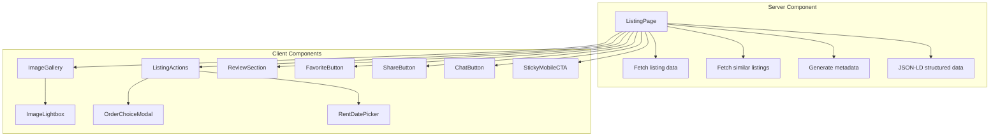
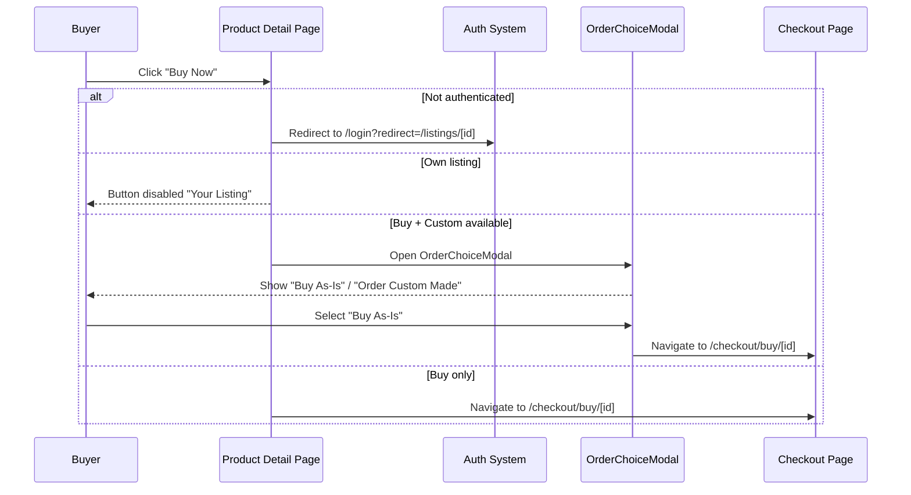
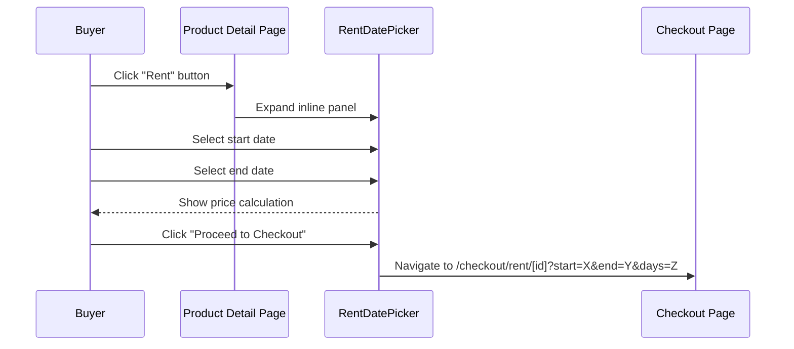
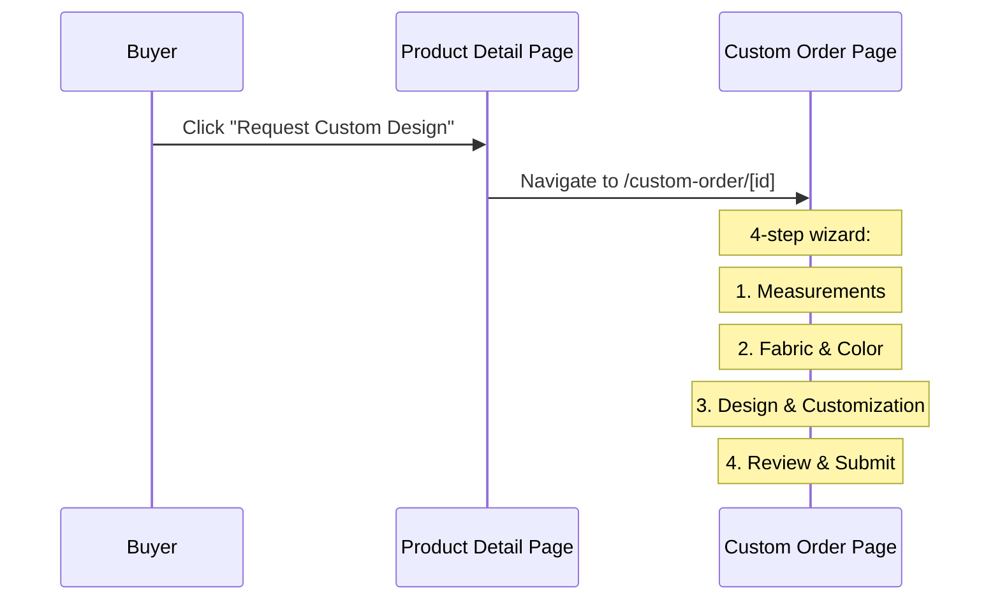

# Product Detail Page — Design Document

## Overview

The Product Detail Page (PDP) is a Next.js 14 App Router page at `/listings/[id]` that serves as the primary conversion surface for the Ethiopian Fashion Marketplace. It supports three business models — Buy (green), Rent (gold), and Custom Order (wine) — within a unified page layout. The page uses server-side rendering for SEO-critical content, client-side interactivity for actions and modals, and leverages the existing design system tokens (`--buy`, `--rent`, `--custom`) and component library from `@marketplace/ui`.

### Key Design Goals

1. **Conversion-Optimized**: Clear pricing hierarchy, prominent CTAs, and friction-free purchase flows
2. **Multi-Model Support**: Seamless coexistence of Buy/Rent/Custom without tabs or separate pages
3. **Mobile-First**: Sticky CTA bar, swipeable gallery, touch-optimized interactions
4. **Trust Building**: Verified seller badges, reviews with verified purchase tags, contact options
5. **SEO Excellence**: Server-rendered content, JSON-LD structured data, Open Graph meta tags

### Technology Stack

- **Framework**: Next.js 14 (App Router, Server Components)
- **Language**: TypeScript 5.7+ (strict mode, `exactOptionalPropertyTypes: true`)
- **Styling**: TailwindCSS 3.4+ with custom design tokens
- **State**: React `useState` for local UI state, Zustand for auth
- **Data Fetching**: Server-side `serverGet()` with ISR revalidation
- **Design System**: `@marketplace/ui` (Button, Badge, Avatar, Rating, Pagination, Modal)
- **Fonts**: Playfair Display (`font-display`), Inter (`font-sans`), Noto Sans Ethiopic (`font-amharic`)

## Architecture

### Page Architecture



### Page Layout Structure

```
┌─────────────────────────────────────────────────────────┐
│ BreadcrumbNav: Home > Category > Title                  │
├─────────────────────────────────────────────────────────┤
│ ┌──────────────────────┐ ┌────────────────────────────┐ │
│ │                      │ │ Title          [Share][Save]│ │
│ │   Image Gallery      │ │ Price (Buy / Rent / Custom) │ │
│ │   (55% desktop)      │ │ Badges (condition, featured)│ │
│ │                      │ │                             │ │
│ │   [1/8]              │ │ [Buy Now]  [Rent]  [Custom] │ │
│ │                      │ │                             │ │
│ │   [thumb][thumb]...  │ │ Rental Info Panel           │ │
│ │                      │ │ Custom Request Card         │ │
│ │                      │ │                             │ │
│ │                      │ │ Seller Card + Contact       │ │
│ │                      │ │ Location & Meta             │ │
│ └──────────────────────┘ └────────────────────────────┘ │
├─────────────────────────────────────────────────────────┤
│ Description (expandable)                                │
├─────────────────────────────────────────────────────────┤
│ Reviews (summary + list + write form)                   │
├─────────────────────────────────────────────────────────┤
│ Similar Listings (4-col grid)                           │
└─────────────────────────────────────────────────────────┘
│ Sticky Mobile CTA (mobile only, fixed bottom)           │
└─────────────────────────────────────────────────────────┘
```

## Component Specifications

### 1. ImageGallery (Enhanced)

**File**: `apps/web/src/components/marketplace/ImageGallery.tsx`  
**Status**: Exists — requires enhancement

**Props Interface:**
```typescript
interface ImageGalleryImage {
  url: string
  alt?: string
}

interface ImageGalleryProps {
  images: ImageGalleryImage[]
  listingType?: 'buy' | 'rent' | 'custom' | 'mixed'
  className?: string
}
```

**Enhancements:**
- Add image counter badge: top-right overlay `"3/8"`, `bg-black/50 text-white rounded-full px-2 py-0.5 text-xs`
- Add listing type badge: top-left, using `Tag` component with appropriate variant
- Add zoom-on-hover for desktop: `hover:scale-105 transition-transform duration-300` inside `overflow-hidden` container
- Add click-to-lightbox: clicking main image opens `ImageLightbox` component
- Increase thumbnail size on desktop: `h-16 w-16 md:h-20 md:w-20`
- Add `aria-label="View image {n}"` to thumbnails

**Main Image Container:**
```tsx
<div className="relative aspect-[4/3] overflow-hidden rounded-xl bg-muted cursor-zoom-in">
  
  {/* Counter badge */}
  <div className="absolute top-3 right-3 bg-black/50 text-white rounded-full px-2 py-0.5 text-xs">
    {activeIndex + 1}/{images.length}
  </div>
  {/* Type badge */}
  {listingType && (
    <div className="absolute top-3 left-3">
      <Tag variant={listingType} size="sm">{typeLabels[listingType]}</Tag>
    </div>
  )}
</div>
```

### 2. ImageLightbox (New)

**File**: `apps/web/src/components/marketplace/ImageLightbox.tsx`  
**Status**: New component

**Props Interface:**
```typescript
interface ImageLightboxProps {
  images: ImageGalleryImage[]
  initialIndex: number
  open: boolean
  onClose: () => void
}
```

**Behavior:**
- Full-screen modal overlay: `fixed inset-0 z-modal bg-black/90`
- Centered image: `max-w-[90vw] max-h-[90vh] object-contain`
- Navigation: Left/right arrow buttons + keyboard (ArrowLeft, ArrowRight, Escape)
- Close button: top-right, X icon
- Image counter: bottom center, `"3 of 8"`
- Mobile: Swipe left/right gesture support via touch events
- Trap focus inside lightbox when open
- Animate in/out with fade transition

**Implementation Notes:**
- Use React Portal to render at document body level
- Use `useEffect` for keyboard event listeners
- Use `touchstart`/`touchend` events for swipe detection (threshold: 50px)
- Prevent body scroll when open (`overflow: hidden` on body)

### 3. StickyMobileCTA (New)

**File**: `apps/web/src/components/marketplace/StickyMobileCTA.tsx`  
**Status**: New component

**Props Interface:**
```typescript
interface StickyMobileCTAProps {
  price: number
  currency: string
  availableForPurchase: boolean
  availableForRent: boolean
  customOrderAvailable: boolean
  rentalPricePerDay: number | null
  onBuyClick: () => void
  onRentClick: () => void
  onCustomClick: () => void
  isOwnListing: boolean
  className?: string
}
```

**Layout:**
```
┌─────────────────────────────────────────┐
│ $5,200              [Buy Now]  [♥] [↗] │
└─────────────────────────────────────────┘
```

**Styling:**
```tsx
<div className="fixed bottom-16 left-0 right-0 z-sticky lg:hidden
                bg-card/95 backdrop-blur-md border-t shadow-lg px-4 py-3">
  <div className="flex items-center justify-between">
    <div>
      <p className="text-lg font-bold text-action-buy">
        {currency} {price.toLocaleString()}
      </p>
      {availableForRent && rentalPricePerDay && (
        <p className="text-xs text-muted-foreground">
          or {currency}{rentalPricePerDay}/day
        </p>
      )}
    </div>
    <div className="flex items-center gap-2">
      {/* Primary CTA based on availability priority: Buy > Rent > Custom */}
      {availableForPurchase && (
        <Button onClick={onBuyClick} disabled={isOwnListing}
                className="bg-action-buy text-white px-6">
          Buy Now
        </Button>
      )}
      {/* Secondary actions as icon buttons */}
    </div>
  </div>
</div>
```

**Visibility:** `lg:hidden` — only visible on mobile viewports (<1024px)

### 4. SellerInfoCard (New — Extracted)

**File**: `apps/web/src/components/marketplace/SellerInfoCard.tsx`  
**Status**: New component (extraction from page)

**Props Interface:**
```typescript
interface SellerInfoCardProps {
  seller: {
    id: string
    name: string
    avatarUrl?: string | null
    emailVerifiedAt?: string | null
    phoneVerifiedAt?: string | null
    createdAt?: string
  }
  contactOptions?: {
    showPhone?: boolean
    whatsapp?: string
    telegram?: string
    inAppMessaging?: boolean
  }
  listingId: string
  className?: string
}
```

**Layout:**
```
┌─────────────────────────────────────┐
│ [Avatar] Seller Name  [Verified]    │
│          Member since 2024          │
│          View profile →             │
├─────────────────────────────────────┤
│ [Call] [WhatsApp] [Telegram] [Msg]  │
│ [Chat with Seller]                  │
└─────────────────────────────────────┘
```

**Styling:**
- Card: `rounded-lg border bg-card p-4`
- Avatar: `size="lg"` with verified badge from `@marketplace/ui`
- Name: `font-semibold text-card-foreground group-hover:text-primary transition-colors`
- "Member since": `text-xs text-muted-foreground`
- Contact buttons: Horizontal flex-wrap row with `gap-2`
- Each contact button: `inline-flex items-center gap-2 rounded-lg px-4 py-2 text-sm font-medium transition-colors`

### 5. AttributeGrid (New)

**File**: `apps/web/src/components/marketplace/AttributeGrid.tsx`  
**Status**: New component

**Props Interface:**
```typescript
interface AttributeGridProps {
  attributes: Record<string, string | number | boolean>
  className?: string
}
```

**Layout:**
```
┌─────────────────────────────────────┐
│ Fabric      Silk                    │
│ Color       Burgundy                │
│ Size        Medium                  │
│ Occasion    Wedding                 │
└─────────────────────────────────────┘
```

**Styling:**
```tsx
<div className="grid grid-cols-1 sm:grid-cols-2 gap-3">
  {Object.entries(attributes).map(([key, value]) => (
    <div key={key} className="flex flex-col">
      <span className="text-xs font-medium text-muted-foreground uppercase tracking-wide">
        {formatLabel(key)}
      </span>
      <span className="text-sm text-foreground">
        {String(value)}
      </span>
    </div>
  ))}
</div>
```

**`formatLabel` helper:** Converts camelCase/snake_case keys to Title Case (e.g., `fabricType` → `Fabric Type`)

### 6. ListingActions (Existing — Enhanced)

**File**: `apps/web/src/components/marketplace/ListingActions.tsx`  
**Status**: Exists — enhance with improved styling

**Current Props:** (unchanged)
```typescript
interface ListingActionsProps {
  listingId: string
  price: number
  currency: string
  availableForPurchase: boolean
  availableForRent: boolean
  customOrderAvailable: boolean
  rentalPricePerDay: number | null
  rentalDeposit: number | null
  sellerId: string
  className?: string
}
```

**Enhancements:**
- Increase button height to `h-12` for better touch targets
- Add icons to buttons: shopping bag (Buy), calendar (Rent), scissors (Custom)
- Improve button spacing: `gap-3` between buttons
- Add subtle hover animation: `hover:scale-[1.02] transition-transform`

### 7. ReviewSection (Existing)

**File**: `apps/web/src/components/marketplace/ReviewSection.tsx`  
**Status**: Exists — no changes needed

**Current Features:**
- Review summary with average rating and distribution bars
- Paginated review list (5 per page)
- Write review form with Rating input
- Delete own review capability
- Loading skeletons

### 8. OrderChoiceModal (Existing)

**File**: `apps/web/src/components/marketplace/OrderChoiceModal.tsx`  
**Status**: Exists — no changes needed

**Current Behavior:**
- Triggered when Buy + Custom both available
- Two options: "Buy As-Is" and "Order Custom Made"
- Displays respective prices for each option

### 9. RentDatePicker (Existing)

**File**: `apps/web/src/components/marketplace/RentDatePicker.tsx`  
**Status**: Exists — no changes needed

**Current Features:**
- Start/end date inputs
- Price calculation display
- Proceed to checkout button

### 10. ShareButton (Existing)

**File**: `apps/web/src/components/marketplace/ShareButton.tsx`  
**Status**: Exists — no changes needed

**Current Features:**
- Web Share API with fallback dropdown
- Copy link, WhatsApp, Telegram, Twitter/X, Facebook options

### 11. FavoriteButton (Existing)

**File**: `apps/web/src/components/marketplace/FavoriteButton.tsx`  
**Status**: Exists — no changes needed

**Current Features:**
- Toggle save/unsaved with heart icon
- Auth guard (redirects to login)
- Visual feedback on toggle

## Data Models

### Listing Data (Server-Fetched)

```typescript
interface ListingImage {
  url: string
  isPrimary: boolean
}

interface ListingData {
  id: string
  title: string
  slug: string
  description: string
  price: number
  currency: string
  condition: string
  city: string
  location?: string
  status: string
  isFeatured: boolean
  primaryImageUrl?: string | null
  images?: ListingImage[]
  contactOptions?: {
    showPhone?: boolean
    whatsapp?: string
    telegram?: string
    inAppMessaging?: boolean
  }
  seller?: {
    id: string
    name: string
    avatarUrl?: string | null
    emailVerifiedAt?: string | null
    phoneVerifiedAt?: string | null
    createdAt?: string
  }
  category?: {
    id: string
    name: string
    slug: string
  }
  _count?: {
    favorites: number
    reviews?: number
  }
  availableForPurchase?: boolean
  availableForRent?: boolean
  customOrderAvailable?: boolean
  rentalPricePerDay?: number | null
  rentalDeposit?: number | null
  customOrderBasePrice?: number | null
  customOrderLeadTimeDays?: number | null
  attributes?: Record<string, string | number | boolean>
  viewCount?: number
  createdAt: string
}
```

### JSON-LD Structured Data

```typescript
const jsonLd = {
  '@context': 'https://schema.org',
  '@type': 'Product',
  name: listing.title,
  description: listing.description,
  image: listing.images?.map(img => img.url) ?? [],
  url: `${siteUrl}/listings/${listing.id}`,
  offers: {
    '@type': 'Offer',
    price: listing.price,
    priceCurrency: listing.currency,
    availability: listing.status === 'active'
      ? 'https://schema.org/InStock'
      : 'https://schema.org/OutOfStock',
  },
  seller: listing.seller ? {
    '@type': 'Person',
    name: listing.seller.name,
    url: `${siteUrl}/sellers/${listing.seller.id}`,
  } : undefined,
  aggregateRating: reviewSummary ? {
    '@type': 'AggregateRating',
    ratingValue: reviewSummary.averageRating,
    reviewCount: reviewSummary.totalReviews,
  } : undefined,
}
```

## Page Section Specifications

### Breadcrumb Navigation

```tsx
<nav className="text-sm text-muted-foreground mb-6" aria-label="Breadcrumb">
  <ol className="flex items-center gap-2">
    <li>
      <Link href="/" className="hover:text-foreground transition-colors">Home</Link>
    </li>
    {listing.category && (
      <>
        <li aria-hidden="true">/</li>
        <li>
          <Link href={`/categories/${listing.category.slug}`}
                className="hover:text-foreground transition-colors">
            {listing.category.name}
          </Link>
        </li>
      </>
    )}
    <li aria-hidden="true">/</li>
    <li className="text-foreground truncate max-w-[200px]">{listing.title}</li>
  </ol>
</nav>
```

### Product Info Header

```tsx
<div>
  <div className="flex items-start justify-between gap-4">
    <h1 className="text-2xl lg:text-3xl font-bold font-display text-foreground">
      {listing.title}
    </h1>
    <div className="flex items-center gap-2 shrink-0">
      <ShareButton title={listing.title} url={`${siteUrl}/listings/${listing.id}`} />
      <FavoriteButton listingId={listing.id} />
    </div>
  </div>

  {/* Pricing block */}
  <div className="mt-3 space-y-1">
    {availableForPurchase && (
      <p className="text-3xl font-bold text-action-buy">
        {currency} {price.toLocaleString()}
      </p>
    )}
    {availableForRent && rentalPricePerDay && (
      <p className="text-sm text-muted-foreground flex items-center gap-1.5">
        <CalendarIcon className="h-4 w-4 text-brand-gold" />
        or rent for {currency}{rentalPricePerDay.toLocaleString()}/day
      </p>
    )}
    {customOrderAvailable && customOrderBasePrice && (
      <p className="text-sm text-muted-foreground flex items-center gap-1.5">
        <ScissorsIcon className="h-4 w-4 text-brand-wine" />
        Custom made from {currency}{customOrderBasePrice.toLocaleString()}
      </p>
    )}
  </div>
</div>
```

### Badges Row

```tsx
<div className="flex flex-wrap gap-2">
  {listing.condition && (
    <Badge variant={conditionVariant[listing.condition] ?? 'default'}>
      {listing.condition.replace('_', ' ')}
    </Badge>
  )}
  {listing.isFeatured && <Badge variant="warning">Featured</Badge>}
  {availableForPurchase && <Badge variant="success">Available to Buy</Badge>}
  {availableForRent && <Badge variant="warning">Available to Rent</Badge>}
  {customOrderAvailable && <Badge variant="info">Custom Orders</Badge>}
</div>
```

### Custom Request Card

```tsx
{customOrderAvailable && (
  <div className="rounded-lg border border-brand-wine/20 bg-brand-wine/5 p-4 space-y-3">
    <div className="flex items-center gap-2">
      <ScissorsIcon className="h-5 w-5 text-brand-wine" />
      <h3 className="font-semibold text-brand-wine">Request a Custom Design</h3>
    </div>
    <p className="text-sm text-muted-foreground">
      Get this piece made to your measurements. Choose fabric, color, and fit —
      the designer will confirm pricing.
    </p>
    <ul className="space-y-1.5 text-sm text-muted-foreground">
      <li className="flex items-center gap-2">
        <CheckIcon className="h-4 w-4 text-brand-wine" />
        Submit your measurements
      </li>
      <li className="flex items-center gap-2">
        <CheckIcon className="h-4 w-4 text-brand-wine" />
        Choose fabric & color
      </li>
      <li className="flex items-center gap-2">
        <CheckIcon className="h-4 w-4 text-brand-wine" />
        Add design notes & reference images
      </li>
      {customOrderLeadTimeDays && (
        <li className="flex items-center gap-2">
          <ClockIcon className="h-4 w-4 text-brand-wine" />
          Estimated lead time: {customOrderLeadTimeDays} days
        </li>
      )}
    </ul>
    <p className="text-xs text-muted-foreground italic">
      Price is estimated; designer confirms final quote
    </p>
  </div>
)}
```

### Location & Meta

```tsx
<div className="space-y-2 text-sm text-muted-foreground">
  {listing.city && (
    <div className="flex items-center gap-2">
      <MapPinIcon className="h-4 w-4" />
      <span>{listing.location ?? listing.city}</span>
    </div>
  )}
  <div className="flex items-center gap-2">
    <ClockIcon className="h-4 w-4" />
    <span>Posted {new Date(listing.createdAt).toLocaleDateString()}</span>
  </div>
  {viewCount > 0 && (
    <div className="flex items-center gap-2">
      <EyeIcon className="h-4 w-4" />
      <span>{viewCount} views</span>
    </div>
  )}
  {_count?.favorites > 0 && (
    <div className="flex items-center gap-2">
      <HeartIcon className="h-4 w-4" />
      <span>{_count.favorites} saved</span>
    </div>
  )}
</div>
```

### Description Section

```tsx
<section className="mt-10" aria-labelledby="description-heading">
  <h2 id="description-heading" className="text-xl font-bold text-foreground mb-4">
    Description
  </h2>
  <div className={cn(
    'prose prose-sm max-w-none text-muted-foreground whitespace-pre-wrap',
    !expanded && description.length > 300 && 'line-clamp-6'
  )}>
    {description}
  </div>
  {description.length > 300 && (
    <button
      onClick={() => setExpanded(!expanded)}
      className="mt-2 text-sm font-medium text-primary hover:text-primary/80"
    >
      {expanded ? 'Show less' : 'Read more'}
    </button>
  )}

  {/* Attributes grid */}
  {attributes && Object.keys(attributes).length > 0 && (
    <div className="mt-6">
      <AttributeGrid attributes={attributes} />
    </div>
  )}
</section>
```

### Similar Listings

```tsx
{relatedListings.length > 0 && (
  <section className="mt-12" aria-labelledby="related-heading">
    <h2 id="related-heading" className="text-xl font-bold text-foreground mb-6">
      Similar Listings
    </h2>
    <div className="grid gap-6 grid-cols-2 lg:grid-cols-4">
      {relatedListings.map((rel) => (
        <ListingCard
          key={rel.id}
          id={rel.id}
          title={rel.title}
          price={rel.price}
          {...(rel.primaryImageUrl !== undefined ? { imageUrl: rel.primaryImageUrl } : {})}
        />
      ))}
    </div>
  </section>
)}
```

## Responsive Behavior Matrix

| Element | Mobile (<768px) | Tablet (768-1023px) | Desktop (≥1024px) |
|---------|-----------------|---------------------|-------------------|
| **Layout** | Single column, stacked | Single column, stacked | 2-column (55/45) |
| **Gallery** | Full width | Full width | `col-span-3` |
| **Info panel** | Full width | Full width | `col-span-2` |
| **Image zoom** | Tap to lightbox | Tap to lightbox | Hover zoom + click lightbox |
| **Thumbnails** | `h-16 w-16`, scroll | `h-16 w-16`, scroll | `h-20 w-20` |
| **Action buttons** | In-page + sticky bar | In-page only | In-page only |
| **Similar grid** | 2 columns | 2 columns | 4 columns |
| **Title** | `text-2xl` | `text-2xl` | `text-3xl` |
| **CTA bar** | Visible, fixed bottom | Hidden | Hidden |
| **Contact buttons** | Wrap to multiple rows | Wrap to multiple rows | Horizontal row |
| **Description** | Full width | Full width | Full width |

## Loading States

### Page Loading Skeleton

```tsx
<div className="grid gap-8 lg:grid-cols-5">
  {/* Gallery skeleton */}
  <div className="lg:col-span-3 space-y-3">
    <div className="aspect-[4/3] rounded-xl bg-muted animate-pulse" />
    <div className="flex gap-2">
      {Array.from({ length: 5 }).map((_, i) => (
        <div key={i} className="h-16 w-16 rounded-md bg-muted animate-pulse" />
      ))}
    </div>
  </div>

  {/* Info skeleton */}
  <div className="lg:col-span-2 space-y-6">
    <div className="space-y-3">
      <div className="h-8 bg-muted rounded w-3/4 animate-pulse" />
      <div className="h-10 bg-muted rounded w-1/2 animate-pulse" />
    </div>
    <div className="flex gap-2">
      <div className="h-6 bg-muted rounded w-20 animate-pulse" />
      <div className="h-6 bg-muted rounded w-24 animate-pulse" />
    </div>
    <div className="space-y-3">
      <div className="h-12 bg-muted rounded animate-pulse" />
      <div className="h-12 bg-muted rounded animate-pulse" />
    </div>
    <div className="h-24 bg-muted rounded-lg animate-pulse" />
  </div>
</div>
```

### Not Found State

```tsx
<Container>
  <section className="py-16 text-center">
    <div className="mx-auto h-24 w-24 rounded-full bg-muted flex items-center justify-center mb-6">
      <SearchIcon className="h-12 w-12 text-muted-foreground" />
    </div>
    <h1 className="text-2xl font-bold text-foreground">Listing Not Found</h1>
    <p className="mt-4 text-muted-foreground max-w-md mx-auto">
      The listing you are looking for doesn't exist or has been removed.
    </p>
    <Link href="/" className="mt-6 inline-block">
      <Button variant="outline">Go to Homepage</Button>
    </Link>
  </section>
</Container>
```

### Unavailable Listing Overlay

```tsx
{(listing.status === 'sold' || listing.status === 'expired') && (
  <div className="absolute inset-0 bg-background/80 backdrop-blur-sm rounded-xl
                  flex items-center justify-center z-10">
    <div className="text-center p-6">
      <div className="inline-flex h-12 w-12 rounded-full bg-destructive/10
                      items-center justify-center mb-3">
        <XCircleIcon className="h-6 w-6 text-destructive" />
      </div>
      <p className="text-lg font-semibold text-foreground">
        This listing is no longer available
      </p>
      <Link href="/" className="mt-4 inline-block text-sm text-primary hover:text-primary/80">
        Browse other listings
      </Link>
    </div>
  </div>
)}
```

## Interaction Flows

### Buy Flow



### Rent Flow



### Custom Order Flow



## Performance Optimizations

### Server-Side Rendering

- Main listing data fetched server-side with ISR (`revalidate: 60`)
- Similar listings fetched in parallel with `Promise.allSettled`
- JSON-LD and metadata generated server-side
- Critical content visible without JavaScript

### Image Optimization

- Thumbnails use `loading="lazy"` for below-fold images
- Main image uses Next.js `<Image>` component when Cloudinary URL available
- Lightbox images loaded on-demand when lightbox opens

### Code Splitting

```typescript
// Lazy load heavy client components
const ImageLightbox = dynamic(() => import('./ImageLightbox'), {
  loading: () => null,
})
```

### Data Fetching Strategy

```typescript
// Parallel fetching with graceful degradation
const [listingRes, relatedRes] = await Promise.allSettled([
  serverGet(`/listings/${id}`, { revalidate: 60 }),
  serverGet('/listings', {
    revalidate: 60,
    params: { categoryId: listing.categoryId, limit: 4 }
  }),
])
```

## Accessibility Checklist

- [ ] All images have descriptive `alt` text
- [ ] Gallery thumbnails have `aria-label="View image {n}"`
- [ ] Sections use `<section aria-labelledby="...">` pattern
- [ ] Breadcrumb uses `<nav aria-label="Breadcrumb">`
- [ ] All buttons have visible `focus-visible:ring-2 ring-primary` styles
- [ ] Lightbox traps focus and supports Escape to close
- [ ] Color contrast meets WCAG 2.1 AA (4.5:1 for text, 3:1 for large text)
- [ ] Touch targets minimum 44x44px on mobile
- [ ] Skip-to-content link targets `id="main-content"`
- [ ] Star rating keyboard navigable with arrow keys
- [ ] Modal/lightbox use `role="dialog"` and `aria-modal="true"`

## Component Dependency Graph

```
ListingPage (server component)
├── BreadcrumbNav (existing)
├── ImageGallery (enhanced)
│   └── ImageLightbox (new)
├── ShareButton (existing)
├── FavoriteButton (existing)
├── ListingActions (enhanced)
│   ├── OrderChoiceModal (existing)
│   └── RentDatePicker (existing)
├── SellerInfoCard (new, extracted)
│   ├── Avatar (existing, @marketplace/ui)
│   ├── Badge (existing, @marketplace/ui)
│   └── ChatButton (existing)
├── AttributeGrid (new)
├── ReviewSection (existing)
│   ├── Rating (existing, @marketplace/ui)
│   └── Pagination (existing, @marketplace/ui)
├── ListingCard (existing)
└── StickyMobileCTA (new)
```

## Files to Create or Modify

| File | Action | Description |
|------|--------|-------------|
| `components/marketplace/ImageGallery.tsx` | Modify | Add zoom, lightbox trigger, counter badge, type badge |
| `components/marketplace/ImageLightbox.tsx` | Create | Full-screen image viewer with keyboard/swipe nav |
| `components/marketplace/StickyMobileCTA.tsx` | Create | Fixed bottom CTA bar for mobile |
| `components/marketplace/SellerInfoCard.tsx` | Create | Extracted seller info with contact actions |
| `components/marketplace/AttributeGrid.tsx` | Create | JSON attributes key-value display |
| `components/marketplace/ListingActions.tsx` | Modify | Add icons, improve sizing/hover |
| `app/listings/[id]/page.tsx` | Modify | Integrate new components, add sections |

---

**Document Version**: 1.0  
**Last Updated**: 2026-06-17  
**Status**: Ready for Implementation
